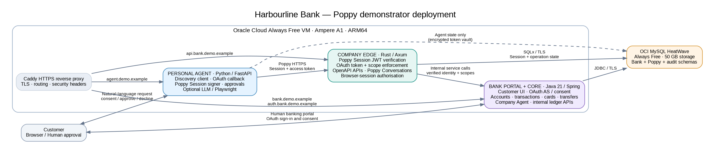

**Document status:** Proposed build specification  
**Specification target:** Personal Agent Protocol (Poppy) draft 0.4  
**Prepared:** 6 November 2026  
**Implementation languages:** Rust, Python and Java  
**Hosting target:** Oracle Cloud Infrastructure (OCI) Always Free  
**Database target:** OCI MySQL HeatWave Always Free  

> **Important:** Harbourline Bank is a fictional demonstration bank. This project must use synthetic customers, accounts, cards, beneficiaries and transactions only. It must not use real customer data, real payment rails, real card numbers or live banking credentials. It is not a banking product and is not suitable for production financial services.

---

# Executive summary

Build an end-to-end demonstrator in which a customer's Personal Agent discovers a Poppy-enabled fictional retail bank, obtains narrowly scoped customer-authorised access, and interacts with the bank through Poppy-compatible APIs, conversations and (in the browser-join milestone) the bank website.

The demo has two independently identifiable protocol participants:

1. **Harbourline Bank (Company):** publishes Poppy discovery metadata, exposes OAuth sign-in, verifies Personal Agent identity and signed Session headers, and offers bank capabilities.
2. **Harbourline Personal Agent (Personal Agent):** publishes its own client metadata and public keys, discovers the bank, signs the customer's Session requests, obtains OAuth tokens after customer consent, and calls the bank's interfaces.

The build should make the protocol observable. The agent UI must include a protocol inspector showing discovery, issuer verification, OAuth, Session creation/continuity, scope decisions, API/conversation requests and operation approvals. Sensitive values must be redacted from the inspector.

## Poppy version decision

Target **draft 0.4** and pin it explicitly in code and test fixtures. The official specification currently identifies itself as draft 0.4 and warns that any part may change, including incompatibly, before 1.0. Keep the protocol adapter versioned so a later draft can be tested without rewriting banking business logic. Do not describe the result as stable-standard or production-certified conformance.

The previous executive briefing referred to draft 0.3. This specification supersedes that version reference and uses the current official draft 0.4 materials available on 6 November 2026.

## Outcomes

- A public dummy bank website with a familiar retail-banking experience.
- A Poppy-enabled Company implementation with discovery, OAuth, Session validation and at least one API plus a Company Agent conversation endpoint.
- A separate Python Personal Agent that uses the published Poppy protocol, rather than a bespoke bank integration.
- An explicit human approval journey for consequential actions, using the Poppy `operations` extension v2.
- A database-backed synthetic ledger and audit trail.
- A repeatable demo script and protocol conformance test plan.

---

# Scope and user journeys

## Functional scope

| Capability | Demo behaviour | Priority |
|---|---|---|
| Public bank website | Landing page, sign-in, dashboard, accounts, transactions, beneficiaries and cards | Must |
| Poppy discovery | `/.well-known/poppy.json`, issuer discovery and version negotiation | Must |
| Personal Agent identity | Public `agent.json`, JWKS, `private_key_jwt` client authentication | Must |
| OAuth Direct Sign-In | Authorization Code + PKCE S256; customer signs in at the bank and consents to scopes | Must |
| Poppy Session | Per-request signed `Poppy-Session` JWT, delegated key and server-side Session state | Must |
| Account APIs | Read account, balance, transaction, beneficiary and card data | Must |
| Bank Company Agent | Poppy Conversations protocol for service questions and handoff | Must |
| Money movement | Simulated transfer requiring exact, explicit approval via Operations extension v2 | Must |
| Card controls | Read card status; freeze/unfreeze simulated card with explicit confirmation | Should |
| Browser Session join | Agent-controlled browser joins the same Poppy Session using a one-time code; access token stays out of browser | Should / Phase 2 |
| MCP endpoint | Optional second API route advertised by Poppy, to demonstrate Poppy + MCP | Later |
| Device Sign-In | Not in first release; Direct Sign-In is preferred and adequate for a banking demo | Out of scope |
| A2A | Not required to demonstrate Poppy; a separate A2A integration can be added later | Out of scope |

## Core demonstration journeys

**Journey A — Discover and inspect**

1. User opens the Personal Agent UI and enters `https://bank.demo.example`.
2. Agent retrieves `/.well-known/poppy.json` over HTTPS.
3. Agent checks the protocol version, organization domain, listed API and Company Agent endpoints, and OAuth issuer relationship.
4. Agent shows the bank's advertised capabilities and scope descriptions in the UI.
5. Protocol inspector shows the request/response metadata with no credentials or bearer tokens exposed.

**Journey B — Connect a bank account**

1. User asks: “Show my current accounts and recent transactions.”
2. Agent determines that `accounts:read` and `transactions:read` are required.
3. Agent opens the bank's Direct Sign-In / OAuth consent page in the user's browser.
4. Customer signs in with a seeded demo account and approves the requested scopes.
5. The bank redirects to the Personal Agent's registered callback with an authorization code and issuer identifier.
6. Agent validates `state` and `iss`, exchanges the code using `private_key_jwt` and the PKCE verifier, and stores the returned refresh token securely.
7. Agent creates a Poppy Session and calls the account and transaction APIs with both the Session header and the OAuth access token.
8. Agent summarises the result without putting tokens or Session JWTs into model context.

**Journey C — Make a simulated transfer with approval**

1. User asks: “Transfer £45 to my saved beneficiary Alex Taylor.”
2. Agent checks whether the existing access grant contains `payments:write`. If not, it initiates a new sign-in requesting all scopes still needed, including previously granted scopes that should be retained.
3. Agent validates that the beneficiary is saved and the requested amount is within demo limits.
4. Agent submits the transfer request. The bank does not move funds; it returns `403 approval_required` with an operation ID, revision, plain-language summary, exact terms and expiry.
5. Agent shows the Company's summary, including amount, currency, source account, beneficiary and whether the action can be undone. It obtains approval through its own UI.
6. Agent resends the exact same request with a `Poppy-Approval` header.
7. Bank verifies the Session, access token, scopes, operation ownership, exact revision, expiry and at-most-once state, then posts a balanced simulated ledger transaction.
8. Replaying the same approval returns the original result; it must not create a second transfer.

**Journey D — Ask the bank's Company Agent**

1. User asks: “What happens if I freeze my card?”
2. Personal Agent starts a Poppy Conversation with the Company's advertised `type: poppy` endpoint.
3. Bank Company Agent responds with a message event, using `author.type: agent`.
4. If a human is requested, the Company Agent changes `responder` / conversation state and exposes a handoff path. Direct Conversation can be added in Phase 2.

**Journey E — Revoke and test the boundary**

1. User disconnects the Personal Agent from the bank.
2. Bank revokes the refresh-token grant and invalidates issued access tokens (or uses short-lived access tokens plus an active-grant check).
3. Agent's subsequent signed-in request fails with `invalid_token`; a signed-out request may continue only for capabilities explicitly made public.
4. Bank ends the Session and rejects later requests using the ended Session ID.

---

# Proposed solution architecture

## Service and language ownership

Use each requested language for a clear bounded context. Avoid implementing the same protocol logic in multiple services.

| Component | Language / framework | Responsibilities |
|---|---|---|
| Company Poppy Edge | **Rust** — Axum, Tokio, Tower | Public bank API façade; Poppy Session JWT verification; client/JWKS and delegated-key validation; scope checks; rate limiting; Poppy conversation transport; browser-session authorisation; safe internal context propagation |
| Bank Portal, OAuth and Core | **Java 21** — Spring Boot, Spring Security, Spring Authorization Server, Spring Data JDBC/JPA, Thymeleaf | Customer portal; login and consent screens; OAuth Authorization Server; customer/account/beneficiary/card domain; simulated ledger and transfers; Company Agent business logic; audit persistence |
| Personal Agent | **Python 3.12+** — FastAPI, httpx, cryptography / JOSE library, Pydantic | Poppy discovery client; `agent.json` and JWKS publishing; OAuth callback; client assertions; delegated key and Session JWT signing; natural-language orchestration; approval UX; optional Playwright browser automation |
| Reverse proxy | Caddy | TLS termination, hostname routing, security headers, request-size limits and access logs with credential-header redaction |
| Data store | OCI MySQL HeatWave Always Free | Synthetic bank data, Poppy Sessions, operations, conversations, OAuth grants and audit events |
| Runtime | Docker Compose on OCI Ampere A1 | One-VM demonstration deployment; health checks, restart policy and resource limits |

**Why this split:** Rust is the public security boundary and has a small runtime footprint; Java is a natural home for the bank domain, web UI and OAuth infrastructure; Python is the agent's orchestration and experimentation layer. The Personal Agent must not query the bank database directly. It interacts with the bank only through Poppy-discovered interfaces.

## Hosting topology and DNS

Use a domain you control. The names below are placeholders and must be replaced before deployment.

| Hostname | Purpose | Routes to |
|---|---|---|
| `bank.demo.example` | Bank website; Poppy discovery; protected-resource metadata; browser-session page | Java portal, with selected Poppy endpoints routed to Rust |
| `auth.bank.demo.example` | OAuth issuer and authorization-server metadata | Java Spring Authorization Server |
| `api.bank.demo.example` | OpenAPI document, account APIs, transfer APIs, Company Agent Conversations | Rust Poppy Edge, then internal Java services |
| `agent.demo.example` | Personal Agent UI, client metadata, public JWKS and OAuth callback | Python FastAPI |

All names point to the OCI VM's public IPv4 address. Caddy routes traffic by hostname to loopback-bound containers. The database must not have a public endpoint exposed to the Internet; allow connectivity only from the app VCN / application subnet.

## Deployment diagram



## OCI Always Free sizing

**Recommended starting shape:** `VM.Standard.A1.Flex`, 2 OCPUs and 12 GB RAM, Ubuntu ARM64, in the tenancy's home region. Oracle's current Always Free documentation describes the A1 allowance as 1,500 OCPU-hours and 9,000 GB-hours per month, equivalent to 2 OCPUs and 12 GB RAM. A1 capacity can be unavailable in some availability domains, and Oracle documents reclaiming idle Always Free compute instances when low CPU/network/memory utilisation persists over a seven-day period. Treat Always Free as a demo hosting allowance, not an uptime commitment. [6]

The target services are ARM64-compatible. Build or select `linux/arm64` container images and verify every native dependency before deployment. Do not assume an x86-only image will run on A1.

Suggested memory budget for a small demo:

| Workload | Initial container limit |
|---|---:|
| Java bank portal + OAuth + core | 1.5–2.5 GB |
| Python Personal Agent | 0.5–1.0 GB |
| Rust Poppy Edge | 256–512 MB |
| Caddy | 64–128 MB |
| OS, Docker, monitoring and headroom | 2–3 GB |

These are starting limits, not measured production sizing. Do not run a large local LLM on this VM. Use deterministic demo intents first, or an external LLM API via a server-side secret if natural-language reasoning is needed.

## Database selection

**Preferred: OCI MySQL HeatWave Always Free.** Oracle documents one standalone Always Free HeatWave instance with 50 GB of storage and 50 GB of backup storage. It keeps the database in the same cloud tenancy and all three languages can use established MySQL drivers. Check that Always Free HeatWave is available in the tenancy's home region before designing around it. [7]

- Java: JDBC / Spring Data.
- Rust: SQLx MySQL driver.
- Python: SQLAlchemy with a MySQL driver such as PyMySQL or mysqlclient.
- Use TLS and a private VCN endpoint / network path. Do not publish port 3306.

**Fallback:** run MySQL 8.4 in a persistent Docker volume on the A1 VM. This keeps the demo self-contained and free, but couples database availability and resource use to the VM. Back up the volume to OCI Object Storage and test restore.

If PostgreSQL is a stronger preference, Supabase Free currently advertises a 500 MB database and pauses projects after one week of inactivity; it is suitable for intermittent experiments but is less attractive for a demo expected to remain continuously available. [8]

## Runtime layout

Use a mono-repository with independent build targets:

```text
harbourline-poppy-demo/
  deploy/
    compose.yaml
    Caddyfile
    env.example
    scripts/                # deploy, seed, backup, restore, smoke tests
  company/
    rust-poppy-edge/        # Axum gateway, Poppy verification, OpenAPI APIs
    java-bank/              # Spring Boot portal, OAuth AS, ledger, Company Agent
  personal-agent/
    python-agent/           # FastAPI UI, Poppy client, signer, orchestration
  database/
    migrations/             # Flyway SQL migrations (single schema owner)
    seed/                   # synthetic demo customers and transactions
  tests/
    conformance/
    security/
    journeys/
  docs/
    protocol-notes/
```

Use Flyway as the single schema migration authority. Rust and Python access the schema but do not independently create or mutate table definitions. Split database permissions by logical schema or table grants even if the free tier is one physical MySQL instance: Java owns `bank_core` and the ledger; Rust receives only the minimum required edge/session/operation grants; Python receives access only to its `agent_state` and encrypted token-vault tables. The Personal Agent must have no `SELECT` permission on `bank_account`, `ledger_entry`, `customer` or other bank-core tables. If MySQL HeatWave access control makes these grants awkward for the demo, use separate database users and restrict the bank schema at the SQL privilege layer.

---

# Poppy protocol implementation specification

## Company discovery document

The Company MUST publish the discovery document at:

`GET https://bank.demo.example/.well-known/poppy.json`

It must be served over HTTPS. The final URL after redirects must still be the well-known path. The document below is an implementation profile; validate its exact schema against the pinned official draft before release.

```json
{
  "protocol_version": "0.4",
  "organization": {
    "name": "Harbourline Demo Bank",
    "domain": "bank.demo.example"
  },
  "auth": {
    "issuer": "https://auth.bank.demo.example",
    "disabled": true,
    "scopes": {
      "accounts:read": "View your accounts, balances and account details",
      "transactions:read": "View your transaction history",
      "beneficiaries:read": "View your saved payment beneficiaries",
      "payments:read": "View your simulated payment history and status",
      "statements:read": "View and download your account statements",
      "cards:read": "View your cards and card status",
      "cards:manage": "Freeze or unfreeze your simulated cards",
      "payments:write": "Create a simulated payment to a saved beneficiary"
    },
    "scope_hints": {
      "accounts:read": { "changes": "none", "personal_data": true },
      "transactions:read": { "changes": "none", "personal_data": true },
      "beneficiaries:read": { "changes": "none", "personal_data": true },
      "payments:read": { "changes": "none", "personal_data": true },
      "statements:read": { "changes": "none", "personal_data": true },
      "cards:read": { "changes": "none", "personal_data": true },
      "cards:manage": { "changes": "reversible", "personal_data": true },
      "payments:write": { "changes": "irreversible", "personal_data": true }
    }
  },
  "agent": {
    "protocols": [
      {
        "type": "poppy",
        "endpoint": "https://api.bank.demo.example/poppy/conversations"
      }
    ]
  },
  "web": {
    "disabled": true
  },
  "apis": [
    {
      "type": "openapi",
      "url": "https://api.bank.demo.example/openapi.json",
      "description": "Accounts, balances, transactions, statements, beneficiaries, cards and simulated transfers"
    }
  ],
}
```

Key rules:

- The example above is the Milestone 1 configuration: `auth.disabled` is `true`, and Operations v2 is deliberately not advertised yet. Change `auth.disabled` to `false` only at Milestone 2, after Direct Sign-In, token issuance, refresh, revocation and grant validation are complete. Add the `operations` version `2` entry only at Milestone 4, after the full approval and at-most-once lifecycle is implemented. The OAuth issuer and metadata remain published while sign-in is disabled.
- `organization.domain` is the host serving `poppy.json`, after redirects.
- The issuer represents exactly one Company. If the demo later uses multiple bank brands/tenants, each must have a distinct issuer.
- Scope hints describe the most consequential operation covered by the scope; they are not a substitute for the consent screen or policy enforcement.
- The Company Agent, APIs and website must enforce the same scope definitions.
- No device grant is advertised in this first release. Direct Sign-In is the preferred flow in draft 0.4 and is the safer fit for a banking-themed demo.
- In Milestones 1–4, `web.disabled` is `true`: the bank website is for human customers, while Personal Agents use the advertised APIs and Company Agent. Do not publish a browser-session endpoint or `poppy:browser-sign-in` until the browser-join flow is implemented and tested in Milestone 5.
- Advertise Operations v2 only if the Company genuinely implements the operation lifecycle and at-most-once execution rules.

## OAuth protected-resource and issuer metadata

At the Company domain, publish RFC 9728 Protected Resource Metadata:

`GET https://bank.demo.example/.well-known/oauth-protected-resource`

```json
{
  "resource": "https://bank.demo.example",
  "authorization_servers": ["https://auth.bank.demo.example"]
}
```

At the issuer, publish RFC 8414 Authorization Server Metadata:

`GET https://auth.bank.demo.example/.well-known/oauth-authorization-server`

The metadata must at least include the exact issuer, authorization endpoint, token endpoint, revocation endpoint, supported grant types (including `refresh_token`), scopes, and `token_endpoint_auth_signing_alg_values_supported`. Because the demo uses Direct Sign-In, advertise `authorization_code`; do not advertise a device endpoint/grant unless implemented.

Example profile:

```json
{
  "issuer": "https://auth.bank.demo.example",
  "authorization_endpoint": "https://auth.bank.demo.example/oauth2/authorize",
  "token_endpoint": "https://auth.bank.demo.example/oauth2/token",
  "revocation_endpoint": "https://auth.bank.demo.example/oauth2/revoke",
  "grant_types_supported": ["authorization_code", "refresh_token"],
  "response_types_supported": ["code"],
  "token_endpoint_auth_methods_supported": ["private_key_jwt"],
  "token_endpoint_auth_signing_alg_values_supported": ["ES256"],
  "code_challenge_methods_supported": ["S256"],
  "scopes_supported": [
    "accounts:read", "transactions:read", "beneficiaries:read", "payments:read",
    "statements:read", "cards:read", "cards:manage", "payments:write"
  ],
  "protected_resources": [
    "https://bank.demo.example"
  ]
}
```

The Personal Agent must discover the issuer through protected-resource metadata and verify that the issuer metadata's `issuer` matches exactly and its `protected_resources` includes the Company domain. Do not silently fall back to a domain identifier after a timeout or invalid metadata response.

For the first demo, the API and Conversation endpoints live on `api.bank.demo.example` but use the Company's default resource (`https://bank.demo.example`). Do **not** list `https://api.bank.demo.example` in `protected_resources` unless the API host is deliberately configured as a separate OAuth resource and publishes its own RFC 9728 Protected Resource Metadata. When such service-specific metadata exists and its `resource` differs from the Company domain, the agent must request a resource-specific token and use it only at that service.

## Personal Agent client metadata

Publish client metadata at:

`GET https://agent.demo.example/agent.json`

```json
{
  "client_id": "https://agent.demo.example/agent.json",
  "client_name": "Harbourline Personal Agent",
  "logo_uri": "https://agent.demo.example/static/agent-logo.png",
  "jwks_uri": "https://agent.demo.example/jwks.json",
  "redirect_uris": ["https://agent.demo.example/oauth/callback"],
  "token_endpoint_auth_method": "private_key_jwt"
}
```

`client_id` must equal the URL of the fetched metadata document. `jwks_uri` and redirect URI must be HTTPS and on the same host as the `client_id`. The JWKS contains public keys only.

The demo Company may allowlist this `client_id` initially. This avoids opening the demo OAuth server to arbitrary clients while retaining the Poppy client identity model. The allowlist must not replace cryptographic verification: fetch/validate the published metadata and use its JWKS for client assertions and Session delegations. Add a controlled onboarding workflow before allowing arbitrary Personal Agents.

## OAuth Direct Sign-In

Implement Authorization Code grant with PKCE S256. The Personal Agent is a confidential OAuth client and authenticates at the token endpoint using `private_key_jwt`.

**Authorization request:**

- `response_type=code`
- `client_id=https://agent.demo.example/agent.json`
- exact registered `redirect_uri`
- `scope` as a space-separated string
- high-entropy `state`
- `code_challenge` and `code_challenge_method=S256`

**Bank consent page must show:**

- “Harbourline Demo Bank” and the customer account being connected;
- Personal Agent display name and the `agent.demo.example` domain;
- plain-language descriptions of requested scopes;
- which scopes expose personal data;
- which scopes permit changes, especially irreversible payment operations;
- how long access lasts and how to disconnect the agent.

The bank redirects with the one-time code and `iss` on success and error responses. The agent validates `state` and checks that `iss` exactly matches the discovered issuer. The agent exchanges the code using a client assertion whose `aud` is the issuer (not the token endpoint URL), a unique `jti`, and a short lifetime. The token endpoint returns an access token and refresh token. The Company must grant no scope the customer did not request; it may grant fewer. A Poppy sign-in must grant at least one scope or be treated as declined.

**Initial token policy for this demo:** access token 10 minutes; refresh token 7 days absolute lifetime; rotate refresh tokens on refresh; never extend absolute expiry by refreshing. These are demo values, not Poppy defaults. Revoke replaced/old refresh tokens as appropriate. Ensure revocation invalidates access tokens promptly through token introspection or a server-side active-grant check.

**Java implementation:** Spring Authorization Server provides the OAuth foundation and supports `private_key_jwt` client authentication. Add a custom client-metadata resolver / `RegisteredClientRepository` adapter that treats the `client_id` as a URL, retrieves the Poppy client metadata and JWKS under strict URL/domain rules, then maps it to an allowed client registration. For the first demo, permit only the published agent URL. Spring Authorization Server does not by itself make an application Poppy-compliant; implement the issuer metadata, `iss` response parameter, redirect matching, Poppy scope rules and client metadata semantics explicitly.

**Access-token profile:** use opaque/reference bearer access tokens for the demo so revocation can be enforced centrally. Rust Edge calls a private Java token-validation endpoint over the internal Docker network; Java resolves the token through Spring Authorization Server's persisted authorization record and returns only `active`, `client_id`, OAuth `sub`, scopes, expiry and the bank customer mapping required for this request. Never expose this internal validation route publicly. Cache positive validation only briefly (for example, 15–30 seconds) and invalidate on revocation. Refresh tokens remain only in the Personal Agent's encrypted token vault; they are never sent to the bank APIs.

## Poppy Session and signed request headers

A Session is not an OAuth token. It connects a user's activity across the Personal Agent's requests and can exist while signed out. A signed-in resource request contains both:

- `Poppy-Session`: a fresh request-bound JWT signed by a short-lived delegated key;
- `Authorization: Bearer <access-token>`: the separate OAuth credential granting account access.

Every request that carries `Poppy-Session` also carries `Poppy-Version: 0.4`. Discovery documents, OAuth endpoints and ordinary website page requests do not carry either header. When the Personal Agent uses Operations v2 with the Company, it declares `Poppy-Extensions: "operations";v="2"` on the relevant requests, using RFC 9651 structured-field syntax.

**Session JWT claim profile:**

| Claim | Required behaviour |
|---|---|
| `iss` | Personal Agent `client_id` URL |
| `aud` | Company identifier; for this demo, OAuth issuer `https://auth.bank.demo.example` |
| `sid` | Cryptographically random, unique Session ID; never reused for another Session |
| `sub` | Stable opaque User ID for this Personal Agent + this Company; not the bank's customer ID |
| `agent_id` | Optional Agent ID; if used, keep it consistent within the Session |
| `htm` | Exact HTTP method of the request |
| `htu` | Request URL without query or fragment, as specified by Poppy / DPoP URL rules |
| `iat` | Unix timestamp for this request |
| `jti` | Unique, unguessable per-request identifier with at least 128 bits of randomness |
| `ath` | SHA-256 hash of the access token, base64url encoded, when an access token is present; absent for signed-out requests |

The JWT protected header must use `typ: poppy-session+jwt`, `alg: ES256`, a `kid` matching the delegated JWK thumbprint, and `poppy_dlg` containing the delegation JWT. Session JWTs do not use an `exp` claim in draft 0.4; the Company accepts them only within its short `iat` freshness window.

**Delegated key model:**

1. Personal Agent publishes its root public key in `jwks.json`.
2. For each Company-specific User ID, it creates a delegated ES256 key pair.
3. Root key signs a `poppy-delegation+jwt` naming only the delegated public key (`cnf.jwk`), with `iss`, `iat`, `exp` and unique `jti`. Delegation expiry must be no more than 24 hours after issue time.
4. The delegated private key signs each fresh Session JWT for that one User ID only.
5. Rotate delegated keys independently. Do not reuse a delegated key across different bank companies or different user identities.

**Company verification sequence:**

1. Require `Poppy-Version` and check compatibility with the document selected by the agent.
2. Parse `Poppy-Session`; reject missing/incorrect `typ`, wrong algorithm, malformed JWT or absent required claims.
3. Resolve `iss` as an HTTPS client metadata URL without redirects. Enforce public DNS/address policy; do not fetch loopback, private or link-local addresses. Verify `client_id` equals the document URL.
4. Fetch/cache `jwks_uri` only after validating it is HTTPS and on the same host as `client_id`.
5. Verify `poppy_dlg` using a root key from the verified JWKS; enforce delegation `iss`, `typ`, algorithm, `kid`, `cnf.jwk`, `iat`, `exp` and unique `jti`.
6. Verify the Session JWT signature with the delegated public key; verify JWK thumbprint, `aud`, `iss`, `sid`, `sub`, `agent_id`, `htm`, `htu` and `iat` freshness.
7. If an access token exists, validate it, check that it was issued to the same `client_id` as Session `iss`, and check `ath` matches that exact token. If no access token exists, require `ath` to be absent.
8. Look up Session state by `(client_id, sid)`. On first valid request, create a signed-out Session. On later requests, enforce the same `sub` and `agent_id`, account binding and Session status.
9. Apply the endpoint's scope requirements. Never infer permission from the fact that a Session JWT is valid.

**Replay protection:** cache Session JWT `jti` values for at least the accepted timestamp window; reject duplicate request proofs. Cache client-assertion and delegation IDs for their applicable validity periods. Use server-side Session state to reject ended Sessions.

## Request error contract

Use the draft's error categories and transport semantics. At minimum:

| Condition | Expected response |
|---|---|
| Missing/invalid Session JWT, invalid delegation, bad `htu`/`htm`/audience | HTTP 400 JSON `{ "error": "invalid_session" }` |
| Session has been ended | HTTP 400 JSON `{ "error": "session_ended" }` |
| Missing/unsupported Poppy version | HTTP 400 JSON `{ "error": "version_unsupported" }` |
| Missing token for an authenticated resource | HTTP 401 with `WWW-Authenticate` challenge naming required scopes |
| Expired/revoked/invalid token | HTTP 401, `invalid_token` challenge |
| Valid token but inadequate scopes | HTTP 403, `insufficient_scope` challenge and required scopes |
| Operations extension not declared where required | HTTP 403 `extension_required` in the location required by the interface |
| Exact operation requires customer confirmation | HTTP 403 JSON `{ "error": "approval_required", "operation": {...} }` |

Never include tokens, Session JWTs, private keys, authorization codes or raw credentials in error responses.

## OpenAPI banking API

Advertise one OpenAPI 3.1 document at `https://api.bank.demo.example/openapi.json`. Every resource operation that uses Session state accepts the required Poppy headers. Signed-in endpoints also require a validated OAuth access token and the relevant scope.

| Method and path | Description | Required scope |
|---|---|---|
| `GET /v1/profile` | Basic customer profile | `accounts:read` |
| `GET /v1/accounts` | List accounts owned by authenticated customer | `accounts:read` |
| `GET /v1/accounts/{account_id}` | Account details and available balance | `accounts:read` |
| `GET /v1/accounts/{account_id}/transactions` | Paginated transactions with date/category filters | `transactions:read` |
| `GET /v1/accounts/{account_id}/statements` | List monthly statement metadata | `statements:read` |
| `GET /v1/statements/{statement_id}/download` | Download the synthetic PDF statement | `statements:read` |
| `GET /v1/beneficiaries` | Saved beneficiaries only | `beneficiaries:read` |
| `GET /v1/cards` | Card summaries; never return full PAN | `cards:read` |
| `POST /v1/cards/{card_id}/freeze` | Freeze demo card | `cards:manage` |
| `POST /v1/cards/{card_id}/unfreeze` | Unfreeze demo card | `cards:manage` |
| `POST /v1/transfers` | Simulated transfer to an existing beneficiary; Operations v2 approval required | `payments:write` |
| `GET /v1/transfers` | List the customer's simulated transfers | `payments:read` |
| `GET /v1/transfers/{transfer_id}` | Read status of a simulated transfer | `payments:read` |

**Transfer request schema:**

```json
{
  "source_account_id": "acc_demo_current_01",
  "beneficiary_id": "ben_demo_01",
  "amount": "45.00",
  "currency": "GBP",
  "reference": "Shared dinner"
}
```

Use decimal strings / SQL `DECIMAL`, never binary floating point for money. Validate currency, account ownership, beneficiary ownership, daily demo limit, available funds and account status. Disallow arbitrary payee details in the initial release; the transfer can only target a beneficiary already saved in the bank portal.

## Operations extension v2 — exact approval for consequential actions

Advertise the official `operations` extension with version `2` in `poppy.json`. The Personal Agent declares it on the relevant requests. The extension's intended flow is: Company returns an operation without performing it; Personal Agent displays the exact Company summary and asks the User; Personal Agent resends the same request with approval; Company validates the operation revision and performs it at most once.

For the bank demo, apply it to `POST /v1/transfers` and optionally card freeze/unfreeze:

- First call performs no side effect and returns `403 approval_required`.
- Operation fields: unique `operation_id`, changing `revision`, human-readable `summary`, structured `terms`, `expires_at`.
- The summary and terms must fully describe source account, beneficiary, amount, currency, reference, fees (zero in demo), execution date and reversibility.
- Personal Agent MUST show the Company's summary as written, the Company name and account context, and obtain a per-operation user decision through its own UI. It must not auto-approve based on previous blanket consent.
- Approval is bound to one operation revision. Any changed amount, beneficiary, account, fee or expiry requires a new revision and fresh approval.
- Retry the exact API request with `Poppy-Approval` containing the two required structured-field string members: `operation_id` and `revision`.
- Company checks operation ownership/Session, access token and scope, revision equality, expiry, exact request terms, operation status and at-most-once rules.
- Commit operation state and balanced ledger entries in one database transaction. A repeated approved operation returns the prior outcome; it must not post again.
- If the Company is still performing the operation, or cannot determine whether it took effect after an internal timeout, return HTTP 503 with `Retry-After` (or the draft's equivalent in-progress response). The Personal Agent retries the exact same request with the same approval; it must not ask for a new approval until the first attempt's outcome is known.

**Trust boundary:** the Operations extension carries the Personal Agent's assertion that the User approved the specific revision. It is not a substitute for the bank's own risk rules or an independent cryptographic signature from the human. The Company must still enforce its limits, authentication, operation binding, audit and duplicate-prevention controls.

## Poppy Conversations protocol

Advertise `agent.protocols` with `type: poppy`. Implement the following routes under the endpoint `https://api.bank.demo.example/poppy/conversations`:

| Method | Route | Purpose |
|---|---|---|
| POST | `/poppy/conversations` | Start a conversation with first message |
| POST | `/poppy/conversations/{id}/messages` | Send another message |
| GET | `/poppy/conversations/{id}/events` | Read events; support cursor and wait parameters |
| POST | `/poppy/conversations/{id}/handoff` | Request a human at the Company |
| POST | `/poppy/conversations/{id}/close` | Close conversation |

Every request carries `Poppy-Session` and `Poppy-Version`, plus an access token when signed in. Conversation ownership is bound to Personal Agent `client_id`, Poppy User ID and (after account use) the bank account. Do not expose whether a conversation exists for a different user/client; return `conversation_not_found` consistently.

Message requirements:

- Personal Agent messages identify `author.type` as `agent` or `human`.
- A summary/paraphrase authored by the AI remains `agent`; use `human` only for the user's actual words.
- Company messages include `role: company` and an `author.type` indicating agent or human.
- Every message has a unique ID from the sender; retries with the same ID and same content must not duplicate the message.
- Event records include `id`, `type` and `created_at`; implement pagination cursor. SSE streaming is a later enhancement.
- Keep conversation status (`working`, `queued`, `idle`) and responder (`agent`, `human`) consistent with event updates.
- Implement handoff and Direct Conversation in Phase 2 if a human operator experience is available. Do not simulate a human responder as an AI.

MVP Company Agent intents:

- Explain account types, transfer limits and card freeze behaviour.
- Explain a specific fee/policy from static demo policy content.
- Guide the customer to an API capability when a structured operation is better.
- Escalate unsupported or sensitive cases via handoff.

For account-specific information, Company Agent tools must invoke the same policy-enforcing service functions as the OpenAPI routes; never rely on the language model to enforce scopes.

## Optional browser-session join

This is a valuable demonstration of the “one Session across channels” concept. Implement it after API and OAuth flows pass.

Only in Milestone 5, when the browser join and scope checks are complete, change `web.disabled` to `false` (or omit it) and advertise `web.browser_session_endpoint` as `https://bank.demo.example/poppy/browser-session`. Add the built-in `poppy:browser-sign-in` scope to the Company scope list and issuer metadata only when the bank has defined exactly what the joined website session can access. For this demo, do not use browser join if it would silently grant the website broader access than the agent's approved scopes.

Flow:

1. Agent-controlled browser performs a top-level GET to the endpoint. Company returns a no-store HTML form with a short-lived one-time `code` and a `Secure; HttpOnly; SameSite=Strict; Path=/` cookie prefixed `__Host-`.
2. Personal Agent reads the code only from the page it loaded in its own controlled browser.
3. Personal Agent posts to `/poppy/browser-session/authorize` with its Poppy Session header and, if signed in, OAuth access token. This endpoint verifies the Session and scopes, ties code to Session/account/scopes, and returns 204.
4. Agent-controlled browser submits the form. Company verifies the cookie/code pair, one-time use and expiry, then sets the Company's own scoped Session cookie for that browser.
5. Agent browses the bank website; the website resolves the cookie to the same Session and enforces the same scopes.

The access token must never pass through the browser. The one-time code must be unguessable, short-lived and single use. Use a strict cookie and CSRF posture. If browser-session access is scoped, the bank website must check the same scopes as APIs; do not grant full account access accidentally. Do not add a `poppy:browser-sign-in` full-access scope unless the site genuinely needs and clearly describes it.

## Optional MCP endpoint

Do not make MCP a prerequisite for the first Poppy demo. Once the OpenAPI and Conversation flows work, add a remote MCP Streamable HTTP server and advertise it as an API entry of type `mcp`. The MCP endpoint must accept Poppy Session headers and the appropriate resource-bound OAuth token; its MCP transport lifecycle is independent of the Poppy Session. For draft 0.4, pin the MCP version/transport supported by the current spec and test the resource audience and token restrictions. Do not assume that an MCP call automatically shares Poppy Session state unless the MCP server verifies and joins that Session.

---

# Banking product and demo UI specification

## Fictional bank identity

Use **Harbourline Demo Bank** (or another clearly fictional name). Use a clean retail-bank layout with a responsive desktop/mobile dashboard, neutral typography, accessible contrast and a clear “DEMO — NO REAL MONEY” banner.

## Bank website pages

| Page | Required elements |
|---|---|
| Landing | Fictional bank identity, demo disclaimer, product summaries, “Sign in” CTA |
| Sign-in | Seeded demo customer login, password reset disabled / demo message |
| OAuth consent | Agent name/domain, customer account, requested scopes in plain English, sensitive-scope warnings, Approve / Decline |
| Dashboard | Current and savings balances, recent activity, card summary, quick links |
| Accounts | Account type, masked account number, sort code equivalent as fictional data, currency and balance |
| Transactions | Search, date filter, category, merchant, amount and status |
| Statements | Monthly statement list, synthetic PDF download, account and period filters |
| Payments | Saved beneficiary list, transfer amount/reference, transfer result and approval state |
| Beneficiaries | View/add/delete synthetic beneficiary records; agent initially read-only |
| Cards | Card nickname, network label (fictional), last four digits only, status, freeze/unfreeze |
| Connections | Connected agents, scopes granted, date connected, revoke access |
| Protocol status | Optional admin-only page showing Poppy version, endpoint health and masked trace IDs |

## Personal Agent UI

- Chat-style prompt area for natural-language tasks.
- Company URL input; default target is the local bank URL.
- Current customer/connection status, granted scopes and token expiry (never token values).
- Approval card displaying the Company's exact operation summary and structured terms; explicit Approve and Decline actions.
- “Activity / protocol trace” timeline: discovery, metadata verification, OAuth redirect, Session proof generation, API call, response, and approval event. Show decoded non-secret JWT claims if useful, but never display raw JWTs, signatures, private keys or bearer tokens.
- Optional browser panel showing the Personal Agent's own browser after the Browser Session join is implemented.
- Clear indicator when an action is simulated and whether it was completed, rejected, pending or not executed.

---

# Data model and persistence

Use MySQL 8.x. Store money as `DECIMAL(19,4)` and timestamps in UTC. Generate all records through a deterministic seed script.

| Table | Key fields / purpose |
|---|---|
| `customer` | `customer_id`, demo display name, email alias, password hash, status |
| `bank_account` | `account_id`, `customer_id`, account type, currency, masked number, opening balance, status |
| `ledger_transaction` | `ledger_txn_id`, type, amount, currency, operation ID, reference, status, created time |
| `ledger_entry` | `entry_id`, `ledger_txn_id`, `account_id`, DEBIT/CREDIT, amount, currency |
| `account_transaction_view` | Optional indexed denormalised view for timeline display; ledger remains source of truth |
| `beneficiary` | `beneficiary_id`, owner customer, display name, masked destination identifier, status |
| `bank_card` | `card_id`, customer/account, nickname, network label, last four only, status |
| `oauth_grant` | Issuer-side authorisation and refresh-token grant metadata; rely on Spring Authorization Server storage where possible |
| `poppy_client_cache` | Approved `client_id`, metadata/JWKS URI, fetched-at, ETag/cache expiry, allowlist status |
| `poppy_session` | `(client_id, sid)` unique key, Poppy `sub`, optional `agent_id`, status, creation/last-seen/end times, account binding |
| `poppy_replay_jti` | Token/proof identifier, client ID, proof type and expiry for replay detection |
| `poppy_operation` | Operation ID, revision, canonical terms JSON/hash, summary, expiry, requester/session/account binding, status, result reference |
| `poppy_conversation` | Conversation ID, client ID, Poppy User ID, optional account binding, parent ID, status and responder |
| `poppy_conversation_event` | Event ID, conversation ID, message ID, author type, structured data/extensions, cursor/order and timestamp |
| `audit_event` | Actor/client, pseudonymous user, action, object ID, outcome, correlation ID, timestamp; no raw secrets |
| `agent_connection` | Agent-side company issuer, pairwise Poppy User ID, scopes, token reference and connection status |
| `agent_secret_ref` | Agent-side encrypted token references; private keys stored separately with restrictive permissions |

## Ledger invariants

- Every posted transfer creates a debit and credit entry in one database transaction.
- Total debits equal total credits for each posted ledger transaction and currency.
- Account balance changes and operation completion state commit atomically.
- A transfer can only debit an account owned by the authenticated customer.
- Beneficiary must be active and owned by the customer.
- Use unique constraints on `operation_id` and ledger reference to prevent duplicates.
- Never store full PAN, CVV, PIN, online banking password or any real payment instrument data.

## Synthetic seed data

Seed at least two fictional customers, one current and one savings account per customer, 30–60 transactions spanning several months, 2–4 saved beneficiaries each, and 1–2 simulated cards each. Use deterministic values so demo walkthroughs are repeatable. Credentials must be generated or clearly documented as demo-only; never reuse a personal or corporate password.

---

# Security, privacy and operational controls

This is an Internet-facing demo and must not be treated as safe merely because the data is fake.

## Mandatory controls

- HTTPS only; redirect HTTP to HTTPS.
- Keep SSH ingress limited to the operator's IP where possible. Expose only 80/443 publicly; database port is private.
- No secrets in Git, images, logs, traces, URLs, model prompts or browser local storage.
- Redact `Authorization`, `Poppy-Session`, `DPoP`, `Cookie`, `Poppy-Approval` where sensitive, OAuth codes, client assertions and all credential fields before logging.
- Return `Cache-Control: no-store` on token/code-bearing responses.
- OAuth consent flow: PKCE S256 only, exact redirect URI, CSRF protection, issuer (`iss`) on success and error redirects, client assertion verification, replay protection.
- JWT verification: allowlist explicit algorithms; reject `none` and symmetric algorithms; verify issuer, audience, time, key and token type; ignore untrusted `jku`/`x5u` JWT header locations.
- `Poppy-Session` must be request-bound (`htm`/`htu`) and fresh; enforce `ath` when an OAuth token is present.
- Agent metadata and JWKS fetches require HTTPS, same-host checks and protections against SSRF, private IPs, redirects and DNS rebinding.
- Use least-privilege scopes; the gateway and Company Agent tool layer must independently enforce them.
- Rate-limit discovery fetches, OAuth token requests, failed logins, API writes, conversation message creation and one-time browser codes.
- Restrict transfer to seeded beneficiaries and a small configurable demo limit, e.g. £500 per simulated transfer and £1,000 daily total.
- Use an audit record for consent, scope grant, scope denial, sign-in, revocation, Session end, transfer approval, transfer rejection and ledger posting.
- Implement a “reset demo data” admin task that is authenticated and disabled on public deployments unless explicitly enabled.

## Model and prompt security

- The LLM is not a security enforcement point. It can propose an operation; the bank decides if it is permitted.
- The LLM never sees private keys, refresh tokens, access tokens, raw Session JWTs, password values, authorization codes or browser-session codes.
- The Personal Agent's policy layer must reject tool calls that exceed granted scopes before making HTTP requests.
- The Personal Agent must not treat a Company message saying “approved” as user consent. Operations approval must originate from the Personal Agent's own user interaction.
- Treat bank API responses and Company Agent messages as untrusted content; do not follow instructions embedded in transaction descriptions, payee names or policy text that attempt to override agent/system policy.
- Require explicit approval for every operation revision. No remembered blanket consent for money movement.

## Internal trust boundary

The Rust Edge validates Poppy and OAuth inputs at the public edge. It passes a minimal verified internal context to Java, such as:

```json
{
  "poppy_client_id": "https://agent.demo.example/agent.json",
  "poppy_user_id": "usr_pairwise_demo",
  "poppy_session_id": "sid_random_demo",
  "bank_customer_id": "cust_demo_001",
  "scopes": ["accounts:read", "transactions:read"],
  "request_id": "req_demo_123"
}
```

This is an internal example, not a public protocol payload. `bank_customer_id` must be resolved by Java from the validated OAuth subject / issuer-side grant mapping after the access token is verified; it must never be derived from Poppy `sub`, which is an agent-scoped pairwise User ID. Protect the Edge-to-Java channel with a private Docker network and service authentication. Do not forward the public OAuth token or Poppy Session JWT to unrelated internal services. The bank domain service must still check that the internal context contains the scopes required for its operation.

---

# Non-functional requirements

| Area | Target for the demo |
|---|---|
| Availability | Best effort; no production SLA. Add health checks and automatic container restart. |
| Performance | Target p95 under 1 second for simple read APIs excluding LLM latency and external OAuth browser time. |
| Concurrency | 1–5 concurrent demo users is sufficient for first release. |
| Audit | Every state-changing action and consent decision is traceable by correlation ID. |
| Observability | Structured JSON logs, health endpoints and a masked protocol trace panel. |
| Data retention | Synthetic state may be reset; token and audit retention configurable. |
| Accessibility | Consent and approval screens keyboard accessible; clear labels and contrast. |
| Portability | Docker Compose and ARM64-compatible images; local MySQL fallback. |
| Cost | Stay within OCI Always Free resource quotas; external model API, domain and usage above free quotas may cost money. |

---

# Build plan and milestones

Build in thin, demonstrable slices. Do not build an elaborate agent or bank UI before protocol identity and Session verification work.

## Milestone 0 — Infrastructure and fake bank (foundation)

- Create OCI A1 VM in home region, VCN/security rules and DNS records.
- Provision Always Free MySQL HeatWave (or local MySQL fallback).
- Deploy Caddy, Java bank portal and migrations/seed script.
- Build synthetic accounts, transactions, beneficiaries and cards.
- Add `/health` and basic dashboard.

**Exit criteria:** bank website reachable over HTTPS; seed/reset is repeatable; MySQL is private; no production banking integrations exist.

## Milestone 1 — Poppy discovery and signed-out Sessions

- Publish `poppy.json`, RFC 9728 Protected Resource Metadata and complete RFC 8414 issuer metadata for the stable Company identifier. Keep `auth.disabled: true` in `poppy.json` until the sign-in journey is ready, so the agent does not start OAuth prematurely.
- Python Personal Agent publishes `agent.json` and `jwks.json`.
- Rust Edge resolves agent metadata, validates delegated keys and `Poppy-Session`, enforces `Poppy-Version`, creates signed-out Session records and implements error responses.
- Keep account endpoints protected; demonstrate a signed-out Session with public bank capabilities / read-only policy content only.
- Add discovery and Session protocol traces with redaction.

**Exit criteria:** signed-out public capability works, invalid/replayed proofs fail, version negotiation and issuer/domain checks pass. The Company identifier is stable before OAuth is enabled, avoiding a later issuer-driven change to pairwise User IDs and Sessions.

## Milestone 2 — Direct Sign-In and account read APIs

- Enable Poppy sign-in by changing `auth.disabled` to `false` only after authorization, token, refresh and revocation endpoints are functional.
- Implement Spring Authorization Server with authorization code + PKCE S256, `private_key_jwt`, refresh and revocation.
- Implement consent UX and Poppy scope descriptions/hints.
- Add Rust API routes and Java bank-domain service methods.
- Add token introspection / active grant validation and scope enforcement.
- Personal Agent connects, stores encrypted refresh token and calls account/transaction APIs.

**Exit criteria:** user can approve only read scopes, the agent reads only permitted resources, denied scopes remain denied, revocation takes effect.

## Milestone 3 — Company Agent conversations

- Implement Poppy Conversation routes, events, cursor pagination, message-ID idempotency and agent/human author metadata.
- Implement policy/FAQ intents and scope-aware bank tools.
- Add optional handoff and Direct Conversation UX.

**Exit criteria:** a Personal Agent can open, continue, read and close a conversation; message retry does not duplicate events.

## Milestone 4 — Simulated transfer and Operations v2

- Implement transfer proposal and operation lifecycle.
- Add `Poppy-Extensions` negotiation and `Poppy-Approval` handling.
- Implement human approval card and exact terms comparison.
- Commit debit/credit ledger entries and operation completion atomically.
- Add duplicate replay, changed revision, expired operation and insufficient funds tests.

**Exit criteria:** no transfer occurs before approval; one approval causes at most one ledger posting; changed terms need fresh approval.

## Milestone 5 — Browser join and protocol polish

- Enable web support by removing `web.disabled: true`, publish the browser-session endpoint, and add `poppy:browser-sign-in` to scope descriptions / issuer metadata only when its actual access semantics are implemented.
- Implement one-time browser code issuance, `/authorize`, cookie binding, single-use redemption and session-bound browsing.
- Add Playwright agent-controlled browser and show it in the Personal Agent UI.
- Test scope enforcement on website and API consistently.
- Run official Company implementation validator and manual checklist.

**Exit criteria:** the browser is joined to the same Session as API activity; access token never appears in browser navigation or logs; replayed/expired browser codes fail.

## Milestone 6 — Optional MCP interoperability

- Add a Streamable HTTP MCP server with read-only tools such as `list_accounts`, `get_account_balance`, `list_transactions`.
- Advertise it in `poppy.json` as API type `mcp`.
- Fetch RFC 9728 Protected Resource Metadata for the MCP server URL. If it advertises a resource different from `https://bank.demo.example`, request a token with that exact `resource` value and use it only at the MCP service; otherwise use the Company's default token. Validate token audience and Poppy Session per draft 0.4.
- Keep write tools disabled until the Operations v2 approval path is implemented for MCP calls.

---

# Acceptance and test plan

## Discovery and metadata

- `GET /.well-known/poppy.json` returns valid draft 0.4 JSON over HTTPS.
- The Company domain in the document matches the final host after redirects.
- Protected-resource metadata names the intended issuer.
- OAuth AS metadata issuer matches exactly and lists the Company's resource URL.
- Personal Agent `client_id` equals the final `agent.json` URL; `jwks_uri` and redirect URI satisfy same-host HTTPS constraints.
- Unsupported or incompatible versions are rejected without silently using an incompatible document.

## OAuth

- Valid authorization code + PKCE S256 succeeds.
- Wrong `state`, wrong `iss`, wrong redirect URI, wrong PKCE verifier and reused/expired authorization code fail.
- Client assertion with wrong audience, unsupported algorithm, expired assertion or replayed `jti` fails.
- Consent screen accurately describes requested scopes and highlights personal data / irreversible actions.
- Company never grants unrequested scopes.
- Refresh token rotation and revocation work; revoked access no longer authorises protected API calls.

## Session proof

- Missing header, altered method, altered URL, wrong audience, wrong `iss`, wrong `sub`, invalid `ath`, expired delegation, invalid delegated JWK, duplicate `jti` and stale `iat` all fail.
- Session reuse with a different Poppy User ID or Agent ID fails.
- Same valid Session can call the APIs and conversation endpoints.
- Ended Session is rejected as `session_ended`; agent starts a new random Session ID.
- Signed-out request has no `Authorization` and no `ath`; the bank creates only a signed-out Session and grants no account data.

## Scopes and data boundaries

- `accounts:read` cannot retrieve transactions unless `transactions:read` is also granted.
- Read-only access cannot create a transfer or freeze a card.
- Company Agent tools enforce the same scope checks as REST endpoints.
- A user from customer A cannot enumerate or access customer B's account, card, transactions or beneficiaries by changing an ID.
- No API returns full card number, CVV, PIN or other real payment data.

## Operations extension and ledger

- Initial transfer call returns `approval_required` and leaves balances/ledger unchanged.
- Agent approval requires a deliberate user action for that exact operation revision.
- A changed amount, payee, source account, fee or expiry invalidates the old approval.
- Expired, unknown, cross-user or wrong-Session operations fail closed.
- Duplicate approval / network retry produces one transfer and the original result.
- Debit and credit ledger entries balance; no negative balance unless deliberately configured for the test case.
- Decline leaves the ledger unchanged and records a declined audit outcome.

## Conversations and browser join

- Duplicate message ID with identical payload returns the original acceptance; same ID with different payload returns a conflict.
- Conversation is inaccessible to another Personal Agent or Poppy User ID.
- `author.type` differentiates agent and human text correctly.
- Handoff is visible and does not falsely claim an AI reply is human.
- Browser join codes are short-lived, one-time and tied to the browser cookie that loaded them.
- Browser session cookie is Secure, HttpOnly, SameSite and no longer-lived than the Session.
- OAuth access token is never delivered to the browser.

## Official validator

Run the official Poppy Company implementation kit validator against the deployed HTTPS bank endpoints after Milestones 1, 2 and 5. The current company kit targets draft 0.4 and tests the Company side by acting as a test Personal Agent. It requires Node.js 22.18+ and a public HTTPS URL for the validator's test-agent metadata. It does not build or validate the Python Personal Agent in full, so retain an independent agent-to-company integration suite and manual checks for logging/consent UX. [5]

---

# Suggested demo script (8–10 minutes)

1. **Show discovery (1 min):** enter the bank URL; inspector shows `poppy.json`, supported 0.4 version and discovered endpoints.
2. **Show consent (1 min):** ask for recent account activity; agent requests read-only scopes; show the bank's OAuth screen and approve.
3. **Show Session proof (1 min):** inspector shows a redacted `Poppy-Session` and decoded safe claims: client ID, pseudonymous subject, Session ID, method/URL binding, issuer audience and `ath` presence. Do not show the JWT string.
4. **Show data access (1 min):** display accounts and transactions from bank APIs; demonstrate that the agent does not connect directly to MySQL.
5. **Show policy enforcement (1 min):** ask the agent to transfer money with read-only scopes; it should request additional permissions rather than bypass access control.
6. **Show operation approval (2 min):** grant `payments:write`; initiate £45 transfer; bank returns exact operation summary; decline once and show no ledger change; repeat and approve; show balanced ledger entries.
7. **Show at-most-once (1 min):** replay the approved request; show same result and unchanged balance/ledger count.
8. **Show Company Agent (1 min):** ask a bank policy question through the Poppy Conversation endpoint; show conversation event and responder metadata.
9. **Show revocation / browser join (1–2 min):** revoke connection and show invalid token; if Phase 5 is complete, demonstrate a browser joining the agent's Session and browsing with scoped access.

---

# Project decisions and risks

| Decision / risk | Recommended resolution |
|---|---|
| Poppy is a draft and can change | Pin draft 0.4; centralise protocol version handling; re-run official validator after spec updates |
| OAuth client ID is a metadata URL | Use a custom allowlisted client metadata resolver; validate metadata/JWKS and HTTPS same-host constraints |
| Spring Authorization Server is not Poppy-specific | Implement Poppy's exact metadata, claims, scope and redirect requirements around the standard OAuth framework |
| Session validation is more than JWT signature checking | Validate delegation chain, JWK thumbprint, audience, request method/URL, timestamps, replay ID and server-side Session ownership |
| Operations approval is an agent assertion | Display exact terms; require user action; enforce server-side policy, revision binding, expiry and at-most-once ledger posting |
| Oracle Free capacity / idleness | Use a home-region Always Free eligible shape; monitor resource use; retain IaC and database backup/restore procedure |
| LLM nondeterminism | Make every core demo journey deterministic without an LLM; LLM is optional and cannot bypass the policy layer |
| Three languages increase operational surface | Use strict service boundaries; only Java owns banking domain and schema migrations; Rust owns public protocol validation; Python owns Personal Agent logic |
| Browser automation adds complexity | Keep browser join as Phase 5; APIs and Conversations demonstrate Poppy core first |
| False impression of bank affiliation | Use original fictional identity, synthetic data and persistent demo disclaimer |

## Explicit non-goals

- Real banking, Open Banking production connectivity, Faster Payments, SWIFT, card authorisation or settlement.
- Real customer credentials, account numbers, sort codes, card PANs, CVVs or PII.
- Credit decisions, lending, investment suitability, KYC/AML decisions or fraud detection against real people.
- Production identity proofing, production key management, HSM, fraud controls, resilience/DR, regulatory certification or PCI DSS compliance.
- Treating Poppy as an A2A replacement or assuming a Company Agent conversation is an A2A interaction.

---

# Deployment checklist

1. Register or select a domain; create A records for `bank`, `auth.bank`, `api.bank` and `agent` hosts.
2. Create OCI compartment and VCN in the tenancy's home region.
3. Provision an eligible Ampere A1 Ubuntu ARM64 VM (start at 2 OCPU / 12 GB; check Always Free quota and capacity).
4. Configure ingress: 80/443 public; SSH only from operator IP; no public MySQL port.
5. Provision OCI Always Free MySQL HeatWave in the supported home region; create least-privilege app users and a private network path from the VM.
6. Install Docker Engine + Compose and Caddy; deploy health-checked services.
7. Configure hostnames and automatic HTTPS; verify certificate chain and redirects.
8. Load secrets through root-owned environment files or a secret manager; restrict file permissions; exclude `.env`, keys and database dumps from Git.
9. Run Flyway migrations and deterministic synthetic seed.
10. Verify `poppy.json`, protected-resource metadata, OAuth metadata, `agent.json` and JWKS from an external network.
11. Run Poppy Company validator and integration tests; verify redacted logs.
12. Configure OCI budgets / quotas and a backup + restore drill. Treat paid external LLM usage, domain renewal and any usage above Always Free quotas as potential charges.

---

# References (checked 6 November 2026)

[1] Personal Agent Protocol — official draft 0.4 specification:  
https://personalagentprotocol.org/docs/0.4/spec

[2] Personal Agent Protocol — introduction:  
https://personalagentprotocol.org/docs/introduction

[3] Personal Agent Protocol — changelog / draft status:  
https://personalagentprotocol.org/docs/changelog

[4] Personal Agent Protocol — Operations extension v2:  
https://personalagentprotocol.org/docs/0.4/extensions/operations

[5] Personal Agent Protocol — official Company implementation kit and validator (draft 0.4):  
https://personalagentprotocol.org/kit/company

[6] Oracle Cloud Infrastructure — Always Free resources, compute quotas and reclaim policy:  
https://docs.oracle.com/en-us/iaas/Content/FreeTier/freetier_topic-Always_Free_Resources.htm

[7] Oracle Cloud Infrastructure — Always Free services / MySQL HeatWave and storage allowance:  
https://docs.oracle.com/en-us/iaas/Content/FreeTier/freetier_topic-Always_Free_Resources.htm

[8] Supabase — current pricing and Free plan limits (PostgreSQL alternative):  
https://supabase.com/pricing

[9] Spring Authorization Server — supported client authentication and registered-client model:  
https://docs.spring.io/spring-authorization-server/reference/configuration-model.html  
https://docs.spring.io/spring-security/reference/servlet/oauth2/authorization-server/core-model-components.html

---

# Appendix A — Poppy request header example

Illustrative signed-in request (the JWT values below are placeholders and must never be used as literal test credentials):

```http
POST /v1/transfers HTTP/1.1
Host: api.bank.demo.example
Poppy-Version: 0.4
Poppy-Extensions: "operations";v="2"
Poppy-Session: <fresh ES256 poppy-session+jwt>
Authorization: Bearer <OAuth access token>
Content-Type: application/json

{ "source_account_id": "acc_demo_current_01", "beneficiary_id": "ben_demo_01", "amount": "45.00", "currency": "GBP", "reference": "Shared dinner" }
```

After the Company returns `403 approval_required` and the User approves the exact revision in the Personal Agent UI, resend the identical method, URL and JSON body with a fresh request-bound `Poppy-Session` proof and the approval header:

```http
Poppy-Approval: operation_id="op_demo_01", revision="rev_demo_01_a8k2"
```

The example uses the RFC 9651 Dictionary Structured Field syntax. The approved request must preserve the original operation's exact terms. A retry after a timeout reuses the same approval; it must not prompt for a new approval until the first outcome is known.

The `Poppy-Session` proof is signed for this exact HTTP method and URL. It is not a reusable bearer token and must not be sent to the OAuth endpoints or to any unrelated host. Include `Poppy-Approval` only on the second, identical request after the user approves the operation returned by the first call.

# Appendix B — Personal Agent implementation pseudocode

```python
async def connect_company(company_url: str, user_ref: str):
    discovery = await fetch_and_validate_poppy_json(company_url)
    version = negotiate_supported_version(discovery, supported={"0.4"})
    issuer = await discover_and_verify_issuer(discovery)
    client_metadata = await load_own_client_metadata()

    user_id = get_or_create_pairwise_user_id(
        user_ref=user_ref,
        company_identifier=issuer,
    )
    session = load_or_create_session(
        client_id=client_metadata.client_id,
        user_id=user_id,
        company_identifier=issuer,
        protocol_version=version,
    )

    # Sign in only when the requested task requires a protected scope.
    # The human completes Direct Sign-In at the Company's own origin.
    return CompanyConnection(discovery, issuer, user_id, session)

async def call_company_api(connection, method, url, required_scopes, body=None):
    token = await ensure_user_approved_scopes(connection, required_scopes)
    session_jwt = sign_fresh_poppy_session_jwt(
        method=method,
        url=url,
        company_audience=connection.issuer,
        user_id=connection.user_id,
        session_id=connection.session.sid,
        access_token=token,
    )
    return await http_request(
        method=method,
        url=url,
        headers={
            "Poppy-Version": "0.4",
            "Poppy-Session": session_jwt,
            "Authorization": f"Bearer {token}",
        },
        json=body,
    )
```

The pseudocode illustrates the separation of discovery, identity, Session signing and account authorisation; it is not a complete Poppy client implementation. Follow the official specification's full validation, OAuth and security requirements.
